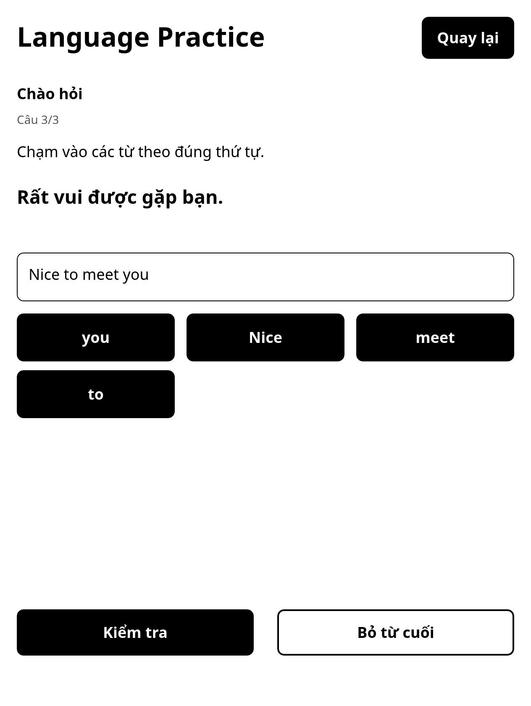
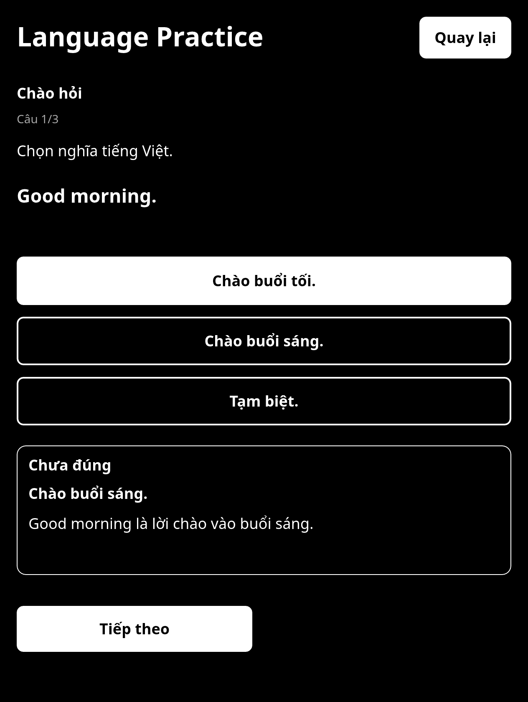

# Language Practice

Language Practice is an original beginner English pack with Vietnamese guidance. It has ten everyday topics and thirty short exercises.

- Tap **Tiếp tục** to continue or choose a topic. A new lesson begins with a sample phrase and its meaning.
- Choose a matching phrase, fill in a blank, or tap word tiles to put them in order. Feedback explains the answer before **Tiếp theo**.
- Tap **Ôn lỗi** to review missed exercises by topic. Lesson progress is saved separately from review.

The app runs offline and needs no keyboard input. Lessons include greetings, introductions, school, family, food, time, directions, daily routines, shopping, and weather.

<table>
  <tr>
    <td></td>
    <td></td>
  </tr>
</table>

The screenshots come from the desktop simulation.

## Install

Find **Language Practice** in PrimitiveOS Store. [Local build and packaging instructions](INSTALL.md)

## Test locally

```sh
cargo test --offline --locked --workspace
cargo run --offline --locked -p language-practice-desktop -- build/previews
```

See `docs/images/` for captured screens. The simulation uses the Launcher fonts from a sibling checkout.

## Licence

Copyright (C) 2026 Doan Nguyen.

The code uses the [PolyForm Noncommercial License 1.0.0](LICENSE).
Project-owned documentation, artwork, screenshots, and original exercise content use [CC BY-NC-SA 4.0](LICENSE-DOCS).
